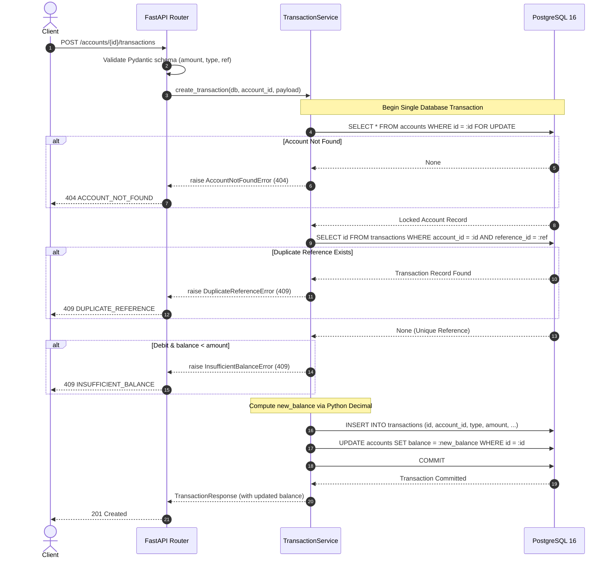

# Technical Design Document

**Project:** Transaction Ledger API  
**Status:** Implemented and Verified  
**Related documents:** [`PRD.md`](./PRD.md), [`TECH_STACK.md`](./TECH_STACK.md), [`API_DOCUMENTATION.md`](./API_DOCUMENTATION.md), [`ASSUMPTIONS.md`](./ASSUMPTIONS.md)

---

## 1. Executive Summary

The Transaction Ledger API is a production-grade, simulated financial ledger system engineered with Python 3.11, FastAPI, SQLAlchemy 2.0, PostgreSQL 16, Pydantic v2, and Alembic. It provides deterministic, ACID-compliant ledger accounting for account creation, monetary credit/debit operations, real-time balance queries, and paginated transaction history.

The system is designed with strict financial integrity invariants:
- Zero initial balance on account creation.
- Strict rejection of debits resulting in a negative balance (overdraft prevention).
- Strict idempotency via per-account unique reference identifiers (`reference_id`).
- Concurrency serialization via PostgreSQL pessimistic row locks (`SELECT ... FOR UPDATE`).
- Immutable append-only ledger entries.
- Dual deployment targets: containerized Docker Compose architecture for local/server environments, and an ASGI serverless runtime on Vercel paired with a Supabase PostgreSQL session pooler.

---

## 2. System Architecture & Request Flow

The architecture follows a clean layered domain pattern:

```text
                               +--------------------------------------------+
                               |              Clients                       |
                               |  (Web Dashboard / Swagger UI / cURL / CI) |
                               +--------------------------------------------+
                                                     |
                                                     v
                               +--------------------------------------------+
                               |     FastAPI Application (ASGI Server)      |
                               |   - VercelRewriterMiddleware (Path normal) |
                               |   - Global Exception Handlers (AppError)   |
                               |   - Static Dashboard Route (GET /)         |
                               +--------------------------------------------+
                                                     |
                                                     v
                               +--------------------------------------------+
                               |         Route Layer (app/api/)             |
                               |  - accounts.py (POST /accounts, balance)   |
                               |  - transactions.py (POST tx, GET history)  |
                               +--------------------------------------------+
                                                     |
                                                     v
                               +--------------------------------------------+
                               |      Pydantic Schemas (app/schemas/)       |
                               |  - Field-level validation (Decimal, Regex) |
                               |  - Extra fields forbidden                  |
                               +--------------------------------------------+
                                                     |
                                                     v
                               +--------------------------------------------+
                               |     Service Layer (app/services/)          |
                               |  - Account & Transaction business logic    |
                               |  - Transaction demarcation (begin/commit)  |
                               +--------------------------------------------+
                                                     |
                                                     v
                               +--------------------------------------------+
                               |    Persistence Layer (SQLAlchemy 2.0 ORM)  |
                               |  - Parameterized ORM queries               |
                               |  - SELECT ... FOR UPDATE pessimistic lock  |
                               +--------------------------------------------+
                                                     |
                                                     v
                               +--------------------------------------------+
                               |       PostgreSQL 16 Database Engine        |
                               |  - accounts (UUID PK, CHECK balance >= 0)  |
                               |  - transactions (UUID PK, UNIQUE ref_id)   |
                               |  - Foreign Key ON DELETE RESTRICT          |
                               +--------------------------------------------+
```

### Layer Responsibilities

1. **Routing & Middleware (`app/main.py`, `app/api/`):** Exposes HTTP endpoints, configures OpenAPI documentation, serves the embedded dashboard UI, and applies `VercelRewriterMiddleware` to normalize URL rewrites in serverless environments.
2. **Schema & Validation (`app/schemas/`):** Validates and sanitizes incoming HTTP payloads using Pydantic v2. Rejects unknown fields (`extra = "forbid"`), validates monetary precision to exactly 2 decimal places, and strips leading/trailing whitespace.
3. **Domain Service Layer (`app/services/`):** Coordinates business transactions, acquires pessimistic row locks, computes ledger balances using Python's arbitrary-precision `Decimal`, validates duplicate references, and ensures ACID consistency.
4. **Database Session & Connection Management (`app/db/`):** Configures SQLAlchemy engine. Employs `QueuePool` in persistent server/container environments and `NullPool` in serverless environments (Vercel) to prevent connection exhaustion.
5. **Database Storage (`PostgreSQL`):** Durable single source of truth enforcing foreign keys, check constraints, composite unique indexes, and serializable row locks.

---

## 3. Actual Project Structure

```text
Transaction_Ledger/
├── .env.example                     # Environment configuration template
├── .gitignore                       # Git ignore definitions
├── Dockerfile                       # Multi-stage container build
├── compose.yaml                     # Local multi-service container orchestration
├── requirements.txt                 # Pinned Python dependencies
├── alembic.ini                      # Alembic database migration configuration
├── vercel.json                      # Vercel serverless deployment specification
├── main.py                          # Root entrypoint
├── api/
│   └── index.py                     # Vercel serverless handler
├── app/
│   ├── __init__.py
│   ├── main.py                      # FastAPI application factory, middleware, exception handlers
│   ├── api/
│   │   ├── __init__.py
│   │   ├── accounts.py              # Account creation and balance endpoints
│   │   └── transactions.py          # Transaction mutation and paginated history endpoints
│   ├── core/
│   │   ├── __init__.py
│   │   ├── config.py                # Pydantic Settings, DB URL parsing, Pool selection
│   │   └── errors.py                # Custom AppError hierarchy and HTTP mappings
│   ├── db/
│   │   ├── __init__.py
│   │   ├── base.py                  # SQLAlchemy DeclarativeBase
│   │   └── session.py               # SessionLocal dependency and engine factory
│   ├── models/
│   │   ├── __init__.py
│   │   ├── account.py               # Account database entity with check constraints
│   │   └── transaction.py           # Transaction database entity with unique constraints
│   ├── schemas/
│   │   ├── __init__.py
│   │   ├── account.py               # Account request/response Pydantic models
│   │   ├── transaction.py           # Transaction mutation, query, and pagination schemas
│   │   └── errors.py                # Standard error envelope schema
│   ├── services/
│   │   ├── __init__.py
│   │   ├── accounts.py              # Account business domain service
│   │   └── transactions.py          # Atomic transaction mutation and history service
│   └── static/
│       └── index.html               # Embedded dashboard SPA (HTML5, Vanilla CSS, JS)
├── migrations/
│   ├── env.py                       # Alembic runtime environment
│   ├── script.py.mako               # Migration template
│   └── versions/
│       └── c1f1a5664db1_create_accounts_and_transactions_tables.py
├── tests/
│   ├── conftest.py                  # Test database fixtures, isolation, and client setup
│   ├── test_accounts.py             # Account validation and retrieval tests
│   ├── test_transactions.py         # Credit/debit validation and balance tests
│   ├── test_history.py              # Filtering, sorting, and pagination tests
│   └── test_concurrency.py          # Parallel debit and race condition tests
└── docs/
    ├── PRD.md                       # Product Requirements Document
    ├── TECH_STACK.md                # Technology choices and rationale
    ├── DESIGN.md                    # Technical Architecture & Design Document (this file)
    ├── ASSUMPTIONS.md               # Engineering assumptions and scope document
    └── API_DOCUMENTATION.md         # Complete API reference and cURL guide
```

---

## 4. Database Schema & Data Integrity

The physical database schema is managed via Alembic revision `c1f1a5664db1`.

### 4.1 `accounts` Table

| Column | Type | Constraints / Modifiers | Description |
|---|---|---|---|
| `id` | `UUID` | `PRIMARY KEY`, default `gen_random_uuid()` | Unique account identifier |
| `name` | `VARCHAR(150)` | `NOT NULL` | Account holder name (1-150 chars, non-blank) |
| `balance` | `NUMERIC(18,2)` | `NOT NULL`, default `0.00`, `CHECK (balance >= 0)` | Stored balance; cannot be negative |
| `created_at` | `TIMESTAMPTZ` | `NOT NULL`, default `CURRENT_TIMESTAMP` | Server-generated account creation timestamp |

### 4.2 `transactions` Table

| Column | Type | Constraints / Modifiers | Description |
|---|---|---|---|
| `id` | `UUID` | `PRIMARY KEY`, default `gen_random_uuid()` | Unique transaction entry identifier |
| `account_id` | `UUID` | `NOT NULL`, `FOREIGN KEY (accounts.id) ON DELETE RESTRICT` | Referenced account |
| `type` | `VARCHAR(10)` | `NOT NULL`, `CHECK (type IN ('credit', 'debit'))` | Ledger mutation operation |
| `amount` | `NUMERIC(18,2)` | `NOT NULL`, `CHECK (amount > 0)` | Monetary quantity (strictly positive) |
| `description` | `VARCHAR(500)` | `NOT NULL` | Descriptive note (1-500 chars) |
| `reference_id` | `VARCHAR(128)` | `NOT NULL` | External idempotency reference |
| `created_at` | `TIMESTAMPTZ` | `NOT NULL`, default `CURRENT_TIMESTAMP` | Ledger entry timestamp |

### 4.3 Database Constraints & Indexes

1. **Foreign Key Protection (`fk_transactions_account_id`):** `ON DELETE RESTRICT` guarantees that an account cannot be deleted if historical ledger entries exist.
2. **Per-Account Reference Uniqueness (`uq_account_reference`):**
   ```sql
   UNIQUE (account_id, reference_id)
   ```
   Ensures absolute idempotency at the storage engine level. Two identical references cannot exist under the same account.
3. **Amount Check Constraint (`ck_transaction_positive_amount`):**
   ```sql
   CHECK (amount > 0)
   ```
   Prevents zero or negative monetary inputs at the database tier.
4. **Balance Check Constraint (`ck_account_non_negative_balance`):**
   ```sql
   CHECK (balance >= 0)
   ```
   Serves as an immutable safeguard against account overdraws, backing up application-level validation.
5. **Composite Historical Query Index (`ix_transactions_account_created_id`):**
   ```sql
   CREATE INDEX ix_transactions_account_created_id ON transactions (account_id, created_at DESC, id DESC);
   ```
   Optimizes transaction history retrieval, timestamp ordering, and deterministic UUID tie-breaking for pagination.

---

## 5. Concurrency Control & Atomic Mutations

### 5.1 The Ledger Invariant

The fundamental invariant of the ledger system is:

$$\text{Stored Account Balance} = \sum (\text{Successful Credits}) - \sum (\text{Successful Debits})$$

$$\text{Stored Account Balance} \ge 0.00$$

### 5.2 Atomic Mutation Lifecycle

Every mutation executed via `POST /accounts/{account_id}/transactions` runs inside a single, discrete database transaction within `TransactionService.create_transaction`:



### 5.3 Concurrency Serialization

1. **Row Lock Acquisition:** `db.execute(select(Account).where(Account.id == account_id).with_for_update())` forces concurrent requests targeting the same account into an orderly queue at the PostgreSQL lock manager.
2. **Deterministic Evaluation:** A second concurrent request cannot read or evaluate `account.balance` until the preceding transaction commits or aborts.
3. **Database-Tier Constraint Safety:** Even in extreme circumstances where locking is bypassed, PostgreSQL's `CHECK (balance >= 0)` and `UNIQUE (account_id, reference_id)` reject conflicting writes and trigger immediate transaction rollback.

---

## 6. Error Handling Strategy

The application wraps all operational, domain, and validation exceptions into a uniform error envelope:

```json
{
  "error": {
    "code": "ERROR_CODE",
    "message": "Human-readable explanation.",
    "details": {}
  }
}
```

### 6.1 Mapped Error Matrix

| HTTP Status | Error Code | Trigger Condition |
|---|---|---|
| `400 Bad Request` | `INVALID_REQUEST` | Malformed JSON syntax or non-parsable body |
| `404 Not Found` | `ACCOUNT_NOT_FOUND` | Path parameter refers to non-existent account UUID |
| `409 Conflict` | `INSUFFICIENT_BALANCE` | Debit amount exceeds locked account's available balance |
| `409 Conflict` | `DUPLICATE_REFERENCE` | `reference_id` already recorded for the given account |
| `422 Unprocessable Entity` | `VALIDATION_ERROR` | Schema failure: negative amount, invalid type, empty strings, invalid pagination |
| `500 Internal Server Error` | `INTERNAL_ERROR` | Unhandled server exceptions (details sanitized from client) |
| `503 Service Unavailable` | `SERVICE_UNAVAILABLE` | Database connectivity failure or health probe timeout |

---

## 7. Frontend Integration & Dashboard Architecture

The web dashboard is delivered as a standalone Single Page Application (SPA) embedded directly in the repository at `app/static/index.html` and served by FastAPI at `GET /`.

### Decoupled Data Flow Architecture

To prevent filter interactions from distorting financial metrics, the frontend implements two completely independent data querying paths:

1. **Financial Overview Aggregation (`fetchOverviewData`):**
   - Queries `GET /accounts/{id}/transactions?limit=100` without transaction type filters.
   - Computes Total Credits, Total Debits, and Net Lifetime Flow across all available transactions.
   - Guarantees that applying a "Credit Only" or "Debit Only" filter in the transaction history table does **not** alter the account overview balances.
2. **Transaction History Display (`fetchTransactionHistory`):**
   - Applies active user filters (`type=credit`, `type=debit`, or all).
   - Manages page-based pagination (`page`, `limit`).
   - Renders the chronological table, timestamp formatting, and badge styling.

---

## 8. Deployment Architecture & Considerations

### 8.1 Docker Compose (Local & Production Server)

- **API Service:** Runs FastAPI inside a lightweight Python 3.11 container (`uvicorn app.main:app --host 0.0.0.0 --port 8000`).
- **PostgreSQL Service:** Dedicated PostgreSQL 16 container with durable named volume (`postgres_data`).
- **Startup Migration:** Entrypoint executes `alembic upgrade head` before booting the Uvicorn web workers.
- **Connection Pooling:** Uses SQLAlchemy `QueuePool` (pool size: 10, max overflow: 20) with pre-ping validation.

### 8.2 Vercel Serverless + Supabase Architecture

- **Serverless Entrypoint:** `api/index.py` exposes `app` directly to Vercel's Python ASGI runtime.
- **Path Normalization:** `VercelRewriterMiddleware` intercepts incoming `__url__` query parameters created by Vercel's rewrite rule (`"source": "/(.*)", "destination": "/api/index.py?__url__=/$1"`) and rewrites `scope["path"]` to ensure seamless routing for Swagger UI, static assets, and API routes.
- **Connection Management:** Configures `NullPool` to prevent pool exhaustion across ephemeral serverless Lambda invocations.
- **Supabase Integration:** Connects to Supabase IPv4 Session Pooler (`port 5432`, `sslmode=require`) to handle transaction queries reliably across distributed serverless function invocations.

---

## 9. Verification & Test Strategy

The test suite validates data consistency, concurrency control, input validation, and boundary conditions. All tests run against a real PostgreSQL instance to ensure transactional behavior is authentically tested.

### 9.1 Test Execution Results

Executed via `docker exec ledger_api pytest -v`:

```text
============================= test session starts ==============================
platform linux -- Python 3.13.17, pytest-8.3.3, pluggy-1.7.0 -- /usr/local/bin/python3.13
cachedir: .pytest_cache
rootdir: /app
plugins: anyio-4.15.1, asyncio-0.24.0
asyncio: mode=Mode.STRICT, default_loop_scope=None
collecting ... collected 48 items

tests/test_accounts.py::test_health_check PASSED                         [  2%]
tests/test_accounts.py::test_create_account_success PASSED               [  4%]
tests/test_accounts.py::test_create_account_name_whitespace_trimmed PASSED [  6%]
tests/test_accounts.py::test_create_account_reject_empty_or_whitespace_name PASSED [  8%]
tests/test_accounts.py::test_create_account_reject_missing_name PASSED   [ 10%]
tests/test_accounts.py::test_create_account_reject_client_supplied_balance PASSED [ 12%]
tests/test_accounts.py::test_create_account_reject_extra_unknown_fields PASSED [ 14%]
tests/test_accounts.py::test_get_account_balance_success PASSED          [ 16%]
tests/test_accounts.py::test_get_account_balance_not_found PASSED        [ 18%]
tests/test_concurrency.py::test_concurrent_debits_prevent_negative_balance PASSED [ 20%]
tests/test_concurrency.py::test_concurrent_duplicate_references PASSED   [ 22%]
tests/test_concurrency.py::test_concurrency_aggregate_invariant PASSED   [ 25%]
tests/test_dashboard.py::test_dashboard_root_serves_html PASSED          [ 27%]
tests/test_dashboard.py::test_dashboard_static_css_accessible PASSED     [ 29%]
tests/test_dashboard.py::test_dashboard_static_js_accessible PASSED      [ 31%]
tests/test_dashboard.py::test_developer_docs_and_health_remain_accessible PASSED [ 33%]
tests/test_history.py::test_history_all_types_and_ordering PASSED        [ 35%]
tests/test_history.py::test_history_filter_by_type PASSED                [ 37%]
tests/test_history.py::test_history_pagination PASSED                    [ 39%]
tests/test_history.py::test_history_empty_results PASSED                 [ 41%]
tests/test_history.py::test_history_account_not_found PASSED             [ 43%]
tests/test_history.py::test_history_invalid_query_params[page=0] PASSED  [ 45%]
tests/test_history.py::test_history_invalid_query_params[page=-1] PASSED [ 47%]
tests/test_history.py::test_history_invalid_query_params[limit=0] PASSED [ 50%]
tests/test_history.py::test_history_invalid_query_params[limit=101] PASSED [ 52%]
tests/test_history.py::test_history_invalid_query_params[type=invalid_type] PASSED [ 54%]
tests/test_transactions.py::test_credit_transaction_success PASSED       [ 56%]
tests/test_transactions.py::test_debit_transaction_success PASSED        [ 58%]
tests/test_transactions.py::test_debit_insufficient_balance_rejected PASSED [ 60%]
tests/test_transactions.py::test_transaction_nonexistent_account PASSED  [ 62%]
tests/test_transactions.py::test_duplicate_reference_same_account_rejected PASSED [ 64%]
tests/test_transactions.py::test_duplicate_reference_different_accounts_accepted PASSED [ 66%]
tests/test_transactions.py::test_reject_invalid_amounts[0.00] PASSED     [ 68%]
tests/test_transactions.py::test_reject_invalid_amounts[-50.00] PASSED   [ 70%]
tests/test_transactions.py::test_reject_invalid_amounts[0] PASSED        [ 72%]
tests/test_transactions.py::test_reject_invalid_amounts[-0.01] PASSED    [ 75%]
tests/test_transactions.py::test_reject_invalid_amounts[100.555] PASSED  [ 77%]
tests/test_transactions.py::test_reject_invalid_amounts[abc] PASSED      [ 79%]
tests/test_transactions.py::test_reject_invalid_amounts[NaN] PASSED      [ 81%]
tests/test_transactions.py::test_reject_invalid_amounts[Infinity] PASSED [ 83%]
tests/test_transactions.py::test_reject_invalid_amounts[] PASSED         [ 85%]
tests/test_transactions.py::test_reject_invalid_transaction_types[deposit] PASSED [ 87%]
tests/test_transactions.py::test_reject_invalid_transaction_types[withdrawal] PASSED [ 89%]
tests/test_transactions.py::test_reject_invalid_transaction_types[transfer] PASSED [ 91%]
tests/test_transactions.py::test_reject_invalid_transaction_types[CREDIT] PASSED [ 93%]
tests/test_transactions.py::test_reject_invalid_transaction_types[] PASSED [ 95%]
tests/test_transactions.py::test_transaction_immutability_no_mutations_allowed PASSED [ 97%]
tests/test_transactions.py::test_atomic_rollback_on_commit_failure PASSED [100%]

======================== 48 passed, 1 warning in 2.43s =========================
```
```

---

## 10. Known Scope Limitations

1. **Simulated Accounting:** The ledger records transactions and balances internally. No external payment networks (SWIFT, ACH, UPI, FedNow) or bank partner rails are integrated.
2. **Demonstration Authentication:** As per the assignment specifications, API routes are unauthenticated. In a production banking deployment, routes must be secured behind mutual TLS, OAuth2/OIDC, and resource-level access control.
3. **Transaction Immutability:** Ledger transactions are append-only. There are no `PUT`, `PATCH`, or `DELETE` endpoints for transactions. Erroneous entries must be corrected through reversing transactions (credit/debit).
